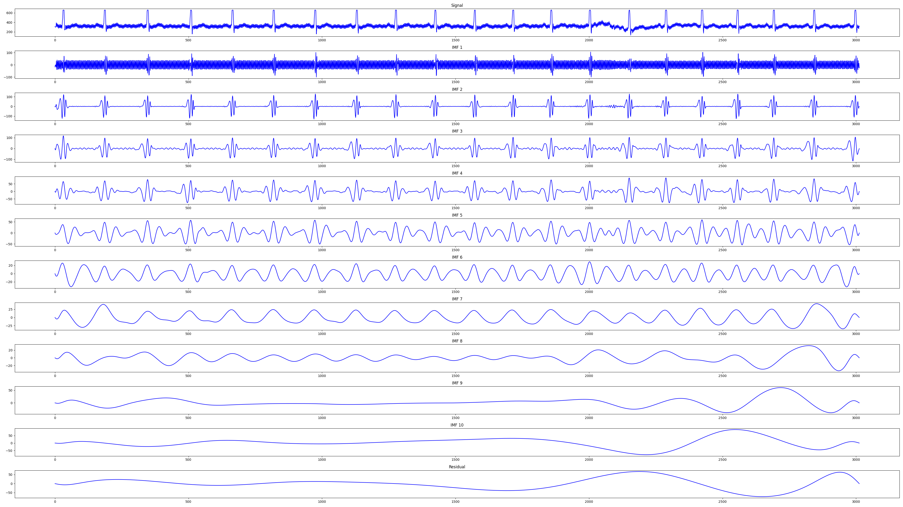
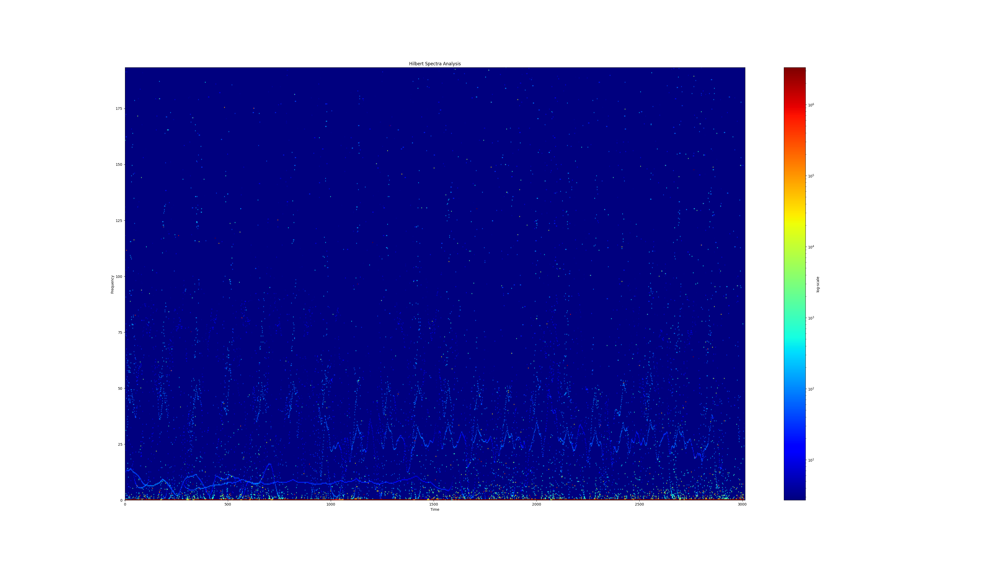
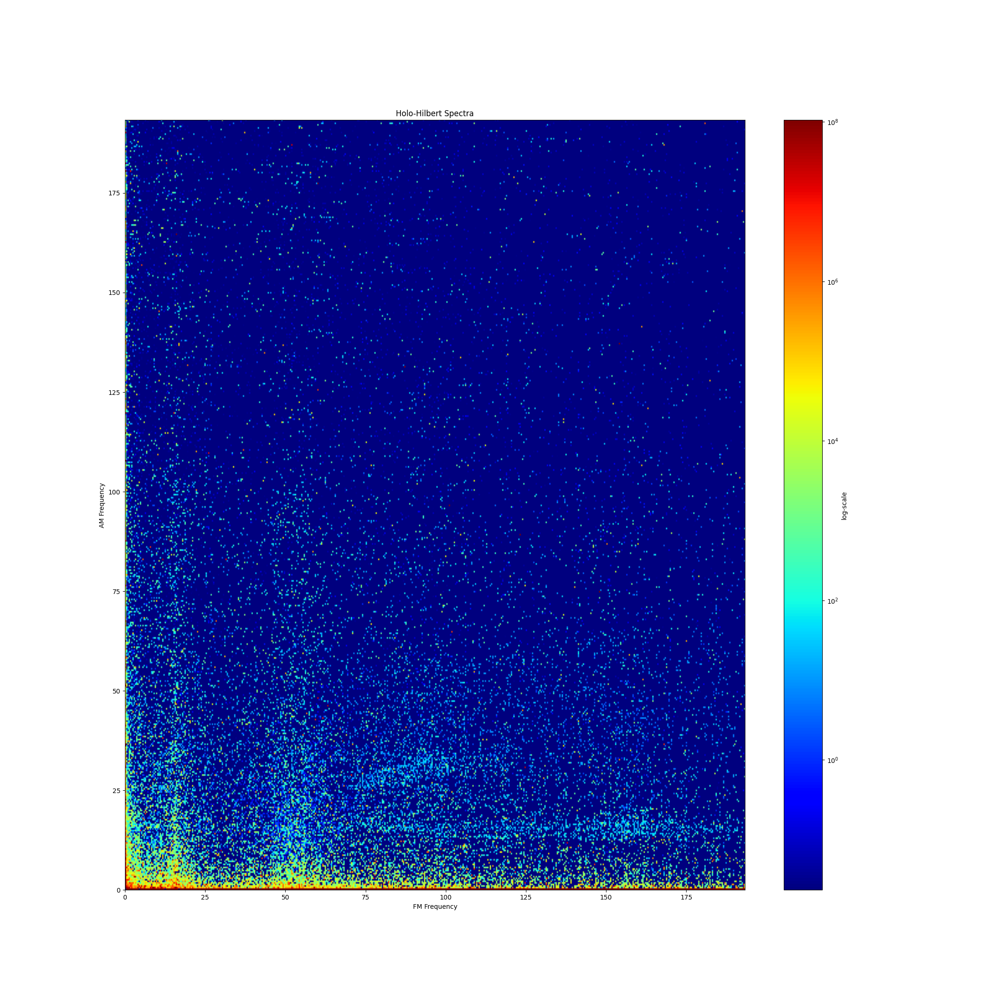
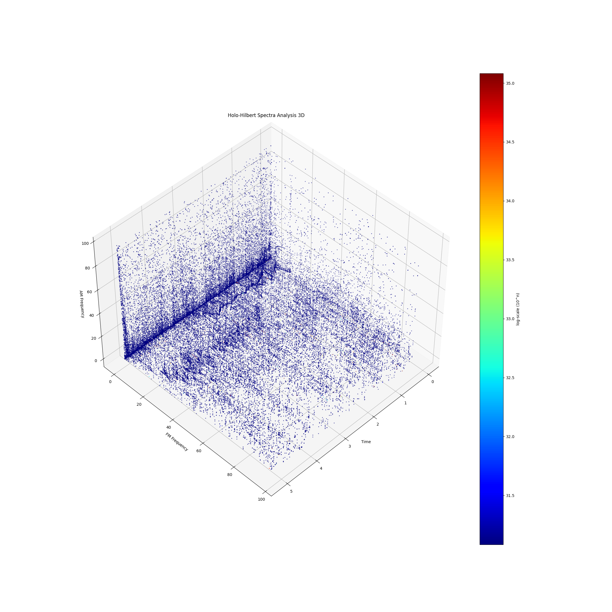
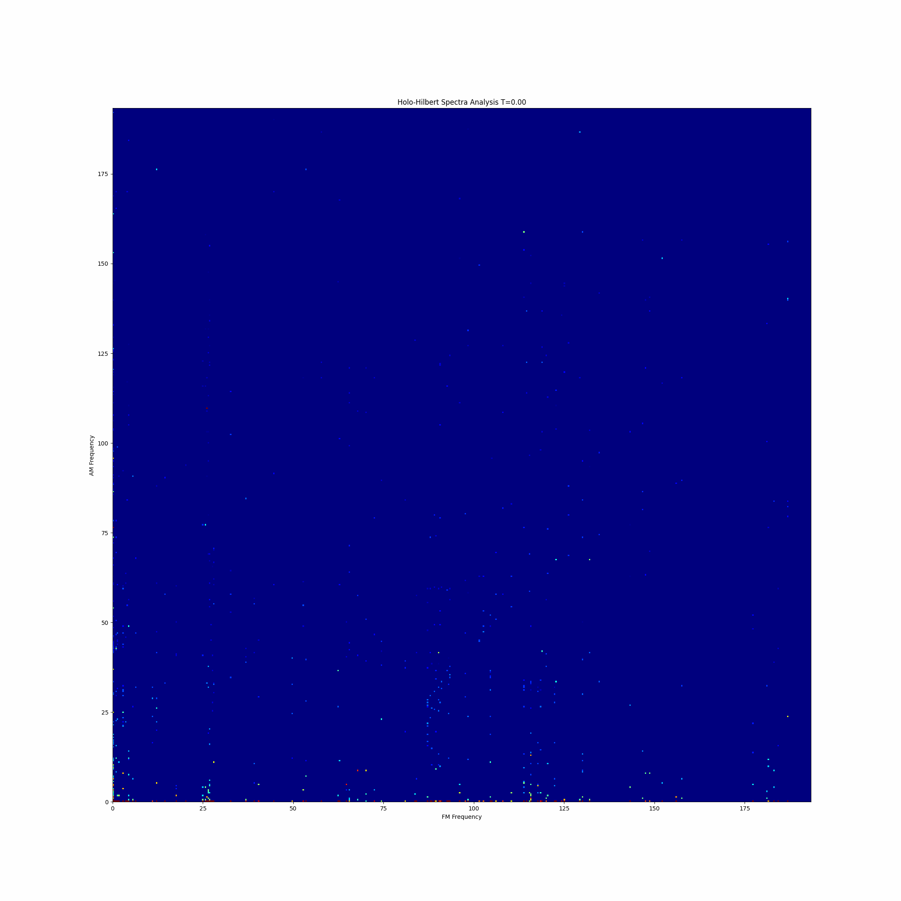

# Holo-Hilbert Spectral Analysis (HHSA)
## PyCUDA / GPU Version
### Known Issue
- This code I generated with AI vibe coding with little human review the code.

- This code not generate same result as original C++ OpenMP version due to floating point precision differences between CPU and GPU.

- The computation difference between Instantaneous Frequency (IF) and Instantaneous Phase (IP) is large. Using double precision may reduce this error, but may increase computation time. This is a trade-off to consider.

- The plot graph is very similar as original C++ version. But not exactly same.

### Introduction
- This program contains the GPU accelerated implementation of the Hilbert–Huang Transform (HHT) and Holo-Hilbert Spectral Analysis (HHSA).

- The implementation ports the original C++ OpenMP algorithm to Python, heavily utilizing **CuPy** and **PyCUDA**. The most computationally expensive part—Cubic Spline computation during Empirical Mode Decomposition (EMD)—has been parallelized via a batched **Thomas Algorithm** (Tridiagonal Matrix Solver) written as a custom PyCUDA kernel.

- By chunking across the *ensemble* dimension (the number of noise iterations), this program can evaluate many Spline interpolations concurrently without consuming excessive GPU VRAM. **The time-domain length of the signal remains strictly intact**, ensuring zero loss of low-frequency signals.

- Supported EMD variants include: **EEMD**, **CEEMD**, and **ICEEMDAN**.

- Maps generation such as HSA, HHS, and 3D HHSA utilize GPU Scatter-Add (`cupyx.scatter_add`) algorithms, completely avoiding CPU-GPU communication overhead until plotting.

### Generated Visualizations

#### Hilbert-Huang Transform (HHT)


#### Hilbert Spectra Analysis (HSA)


#### Holo-Hilbert Spectra (HHS)


#### Holo-Hilbert Spectra Analysis (HHSA)



### Hardware & Software Requirements
- **NVIDIA GPU** with CUDA support.
- Python 3.x
- **CuPy**, **PyCUDA**, **NumPy**
- **Matplotlib**, **imageio**, **tqdm** (for plotting, GIF generation, and progress bar)

### Execution
1. Install dependencies in your Conda environment:
   ```bash
   pip install cupy pycuda numpy matplotlib imageio tqdm
   ```

2. Adjust the configuration parameters inside `HHSA_profile.txt` if needed.

3. Run the script from the command line:
   ```bash
   python main.py HeartRate.txt
   ```

### Output File Explanation
- `HeartRate.txt_HHT.csv`: Contains the detailed result of HHT, including Intrinsic Mode Functions (IMF), Envelopes, Frequency Modulation (FM), Amplitude Modulation (AM), Instantaneous Phase (IP), and Instantaneous Frequency (IF).
- `HeartRate.txt_HSA.png`: Plot of Hilbert Spectra Analysis (Instantaneous Frequency across time).
- `HeartRate.txt_HHSA_mode[NUM].csv`: Results of HHSA on the IMF upper envelopes.
- `HeartRate.txt_HHS.png`: 2D Colormap plotting AM vs FM frequency across all times.
- `HeartRate.txt_HHSA_3D.png`: 3D Scatter plot visualizing AM, FM, and Time.
- `HeartRate.txt_HHSA.gif`: Animation over time-cells showing the shift in spectra.
